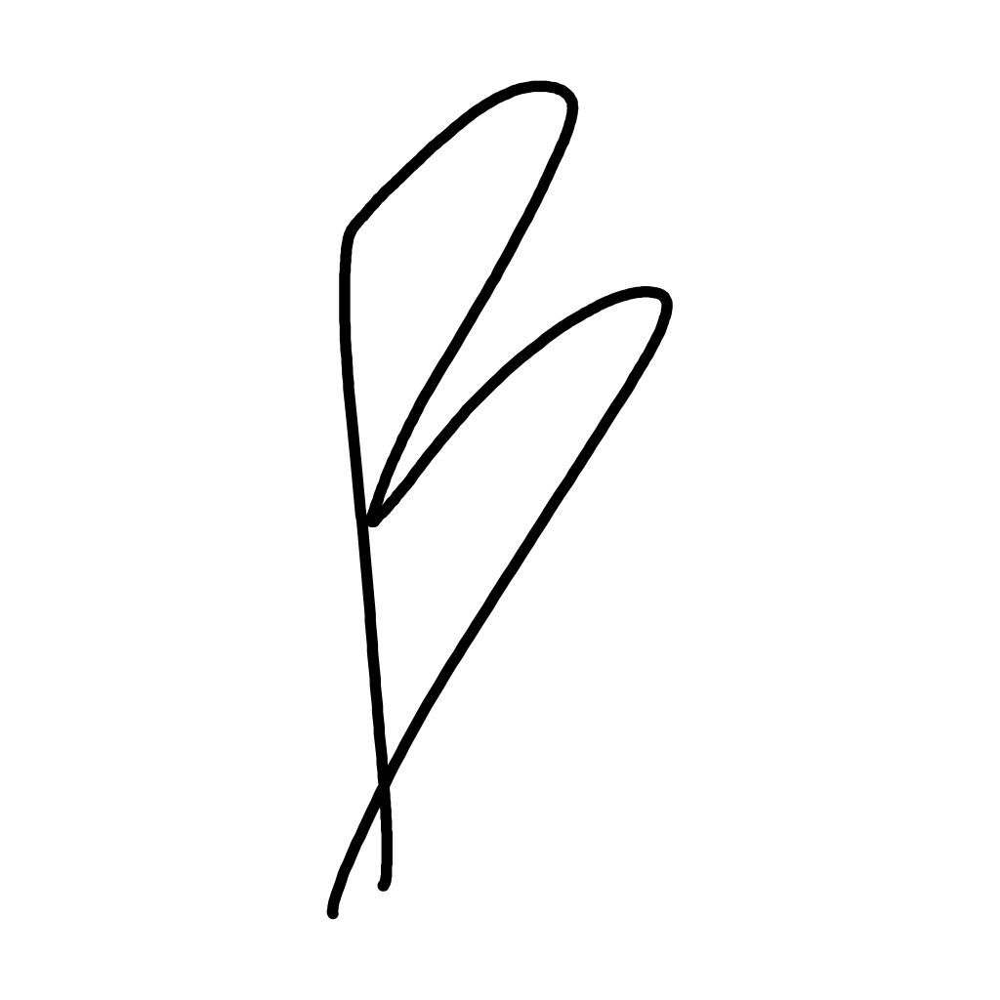

# `brudnopis`

Onyx Boox SDK powered note taking app. Saves to device storage, in a widely
accepted SVG format.

## Standing on the shoulders of giants

This project would not exist without these projects and their authors:

| Project | What we used | License |
|---|---|---|
| [Notable](https://github.com/Ethran/notable) (Ethran fork) | Eraser hit-test algorithm, color palette for color e-ink, SDK version choices, overall SDK usage reference | GPL-3.0 |
| [PngNote](https://github.com/karino2/PngNote) | Stroke artifact filtering, initial architecture spike template | MIT |
| [OnyxAndroidDemo](https://github.com/onyx-intl/OnyxAndroidDemo) | Official SDK documentation and pen style reference | Unlicensed |
| [react-native-sketch-canvas](https://github.com/sourcetoad/react-native-sketch-canvas) | React Native native view bridging pattern reference | MIT |
| [toolsboox-android](https://github.com/gaborauth/toolsboox-android) | HiddenApiBypass pattern reference (since removed) | GPL-3.0 |

The [Onyx Boox SDK](https://repo.boox.com/repository/maven-public/) is vendored
as extracted JARs. The SDK has no published license terms.

## Development with devenv and direnv

On Linux, run `direnv allow` to load the project shell automatically, or use
`devenv shell` directly. Then run `pnpm install` to install the lockfile-managed
dependencies. devenv provides Node and pnpm; outside devenv, developers are
responsible for installing them. Biome and ast-grep are project-local tools,
with devenv wrappers for their Nix runtime requirements. devenv also provides
the Android SDK required by the app.

## License

GPL-3.0 — see [LICENSE](LICENSE).
